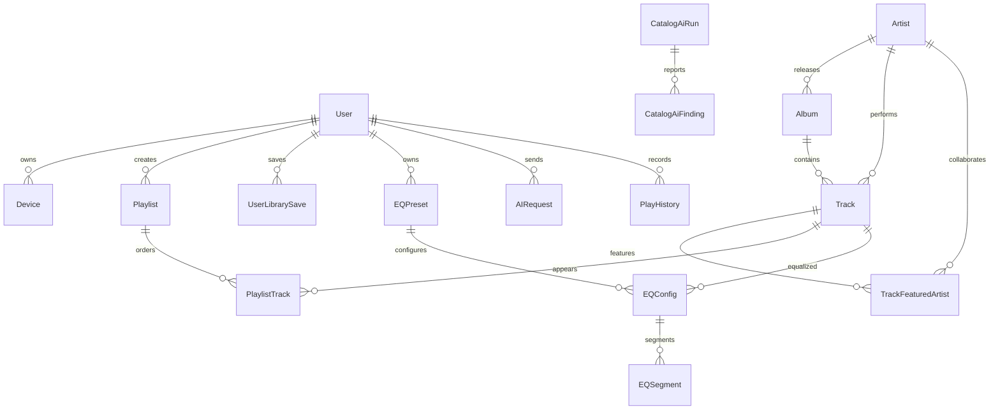

# Base de datos de MusicFlow

MusicFlow usa PostgreSQL 16 como fuente autoritativa del catálogo y de la sincronización. El servicio está dockerizado en `docker-compose.yml` como `musicflow-db` (puerto local `5433`) y Prisma genera el cliente tipado desde `apps/backend/prisma/schema.prisma`.

## Modelo relacional actual



`TrackFeaturedArtist.artistId` puede ser nulo para conservar colaboradores no registrados. Las restricciones únicas, claves foráneas y transacciones evitan duplicados durante cargas, ediciones y sincronización.

## Por qué PostgreSQL

El dominio necesita joins, claves foráneas y transacciones entre catálogo, featuring, playlists, EQ, historial y auditoría. PostgreSQL aporta `jsonb`, índices compuestos y consultas analíticas, mientras Prisma mantiene migraciones reproducibles y tipos TypeScript. MySQL sería viable, pero ofrece menos flexibilidad para `jsonb`; MongoDB obligaría a mantener referencias y consistencia manualmente; Firebase acoplaría datos, auth y almacenamiento a un proveedor. PostgreSQL mantiene portabilidad y una única fuente de verdad.

## Desarrollo local

```bash
docker compose up -d db redis minio
pnpm --dir apps/backend prisma migrate deploy
pnpm --dir apps/backend prisma generate
```

Consulta [COMMANDS.md](../COMMANDS.md) para requisitos y advertencias.
